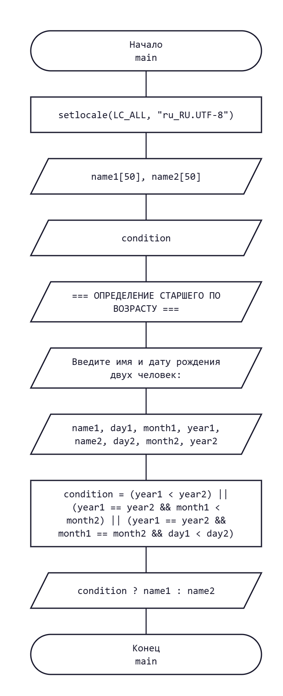

# Домашнее задание к работе 5

## Условие задачи

Написать программу, которая по введенным датам рождения двух человек определяет старшего по возрасту.

Формат ввода: имя, день, месяц и год рождения каждого человека.

Пример: `Mila 12 06 2001` и `Nasty 11 12 2000`.

Результат: `Nasty`.

## 1. Алгоритм и блок-схема

### Алгоритм

1. **Начало.**
2. Задать исходные данные:
   - `name1` — имя первого человека.
   - `day1`, `month1`, `year1` — день, месяц и год рождения первого человека.
   - `name2` — имя второго человека.
   - `day2`, `month2`, `year2` — день, месяц и год рождения второго человека.
3. Считать имена и даты рождения двух человек.
4. Проверить, кто родился раньше:
   - `year1 < year2` — первый человек родился раньше.
   - `year1 == year2 && month1 < month2` — если годы рождения совпадают, сравнить месяцы.
   - `year1 == year2 && month1 == month2 && day1 < day2` — если годы и месяцы совпадают, сравнить дни.
5. Определить старшего по возрасту:
   - Если условие истинно, вывести `name1`.
   - Иначе вывести `name2`.
6. **Конец.**

### Блок-схема



## 2. Реализация программы

```c
#define _CRT_SECURE_NO_DEPRECATE
#include <stdio.h>
#include <locale.h>

int main()
{
    setlocale(LC_ALL, "ru_RU.UTF-8");

    char name1[50], name2[50];
    int day1, month1, year1;
    int day2, month2, year2;
    int condition;

    // Сообщаем пользователю, что делает программа
    printf("=== ОПРЕДЕЛЕНИЕ СТАРШЕГО ПО ВОЗРАСТУ ===\n");
    printf("Введите имя и дату рождения двух человек: ");

    // Считываем имена и даты рождения
    scanf("%49s %d %d %d %49s %d %d %d",
        name1, &day1, &month1, &year1,
        name2, &day2, &month2, &year2);

    // Проверяем, кто родился раньше
    condition = (year1 < year2) ||
        (year1 == year2 && month1 < month2) ||
        (year1 == year2 && month1 == month2 && day1 < day2);

    printf("%s\n", condition ? name1 : name2);

    return 0;
}
```

## 3. Результаты работы программы

**Пример 1.** Первый человек старше второго.

Входные данные:

```text
Mila 12 06 2001
Nasty 11 12 2000
```

Результат:

```text
Nasty
```

**Пример 2.** Второй человек младше первого.

Входные данные:

```text
Alex 15 03 2000
Max 20 08 2002
```

Результат:

```text
Alex
```

## 4. Информация о разработчике

Измалком Илья бИД-261